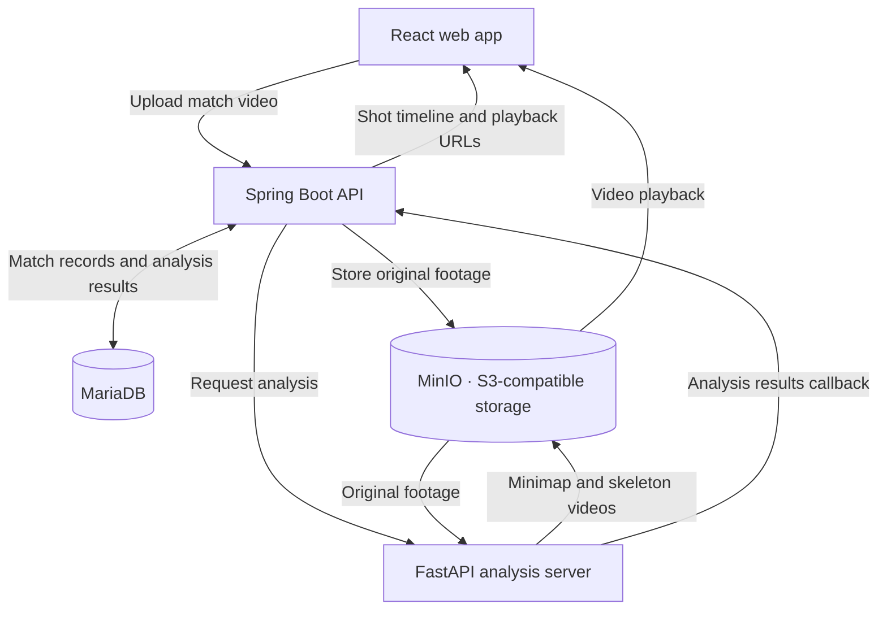

# 🏸 RallyTrack

[한국어](#한국어) · [English](#english)

## 한국어

RallyTrack은 배드민턴 단식 경기를 복기하는 프로젝트입니다. 타임라인에서 타구를 고르면 원본 영상의 해당 장면으로 이동합니다. 영상을 돌려 보면서 코트 미니맵으로 타구 전후 두 선수의 위치를 확인할 수 있습니다.

**[RallyTrack 홈페이지](https://app.rallytrack.win/)**

### 하나의 랠리, 세 가지 분석

| 화면 | 살펴볼 수 있는 내용 |
| --- | --- |
| 원본 영상 | 선수가 셔틀콕에 접근해 타구하는 장면을 경기 영상 그대로 봅니다. |
| 코트 미니맵 | 코트를 위에서 내려다보며 두 선수의 움직임을 따라갑니다. 숫자 표시는 감지된 타구의 순서입니다. |
| 스켈레톤 리플레이 | 코트 도식 위에서 두 선수의 관절 움직임과 셔틀콕 궤적을 함께 봅니다. |

TrackNetV3로 셔틀콕을 추적하고 YOLOv8-pose로 두 선수의 자세를 추정합니다. 셔틀콕의 속도와 방향 변화를 바탕으로 타구 시점을 추정합니다.

### 저장소 안내

| 저장소 | 주요 역할 |
| --- | --- |
| [AI 분석 서버](https://github.com/RallyTrack/aiAnalysis-server) | Python과 FastAPI로 셔틀콕 추적, 자세 추정, 타구 감지, 리플레이 영상 생성을 처리합니다. |
| [프론트엔드](https://github.com/RallyTrack/frontend) | React와 TypeScript로 영상 업로드 화면, 타구 타임라인, 영상 플레이어를 구현합니다. |
| [백엔드](https://github.com/RallyTrack/backend) | 영상 관리, 분석 요청, 결과 조회를 위한 Spring Boot API를 제공합니다. |
| [DevOps](https://github.com/RallyTrack/devops) | Docker Compose 구성과 웹 앱 및 분석 서버의 배포 스크립트를 관리합니다. |

---

## English

RallyTrack is a project for reviewing badminton singles matches. Select a shot on the timeline to jump to that moment in the original footage. As you replay it, the court map shows where both players were before and after the shot.

**[RallyTrack website](https://app.rallytrack.win/)**

### One rally, three ways to analyze it

| View | What you can see |
| --- | --- |
| Original footage | Watch how each player moves toward the shuttlecock and plays the shot. |
| Court map | Follow both players from above. Numbered markers show the order of detected shots. |
| Skeleton replay | See how both players’ joints move and follow the shuttlecock’s path on a court diagram. |

RallyTrack uses TrackNetV3 to track the shuttlecock and YOLOv8-pose to estimate both players’ poses. It estimates when each shot was played from changes in the shuttlecock’s speed and direction.

### Repositories

| Repository | Role |
| --- | --- |
| [AI analysis server](https://github.com/RallyTrack/aiAnalysis-server) | Uses Python and FastAPI to track the shuttlecock, estimate player poses, detect shots, and render replay videos. |
| [Frontend](https://github.com/RallyTrack/frontend) | Implements the video upload screen, shot timeline, and video player in React and TypeScript. |
| [Backend](https://github.com/RallyTrack/backend) | Provides a Spring Boot API for managing videos, requesting analysis, and retrieving results. |
| [DevOps](https://github.com/RallyTrack/devops) | Maintains the Docker Compose configuration and deployment scripts for the web app and analysis server. |

---

## 프로젝트 기간 · Project timeline

| 항목 / Item | 내용 / Details |
| --- | --- |
| 기간 / Duration | 2026.01.17 – 현재 진행 중 (Present) |
| 팀 / Team | 4명 · 프론트엔드 2명, 백엔드 2명 (2 frontend, 2 backend) |

## 시스템 아키텍처 · System architecture

원본 영상과 분석 영상은 MinIO에, 타구 기록과 영상 파일을 가리키는 객체 키는 MariaDB에 저장합니다. 경기를 다시 열면 웹 앱은 API에서 타임라인과 임시 재생 URL을 받아 해당 장면을 재생합니다.

MinIO stores the original footage and rendered videos. MariaDB stores shot records and the object keys for those files. When a viewer opens a match, the web app gets the timeline and temporary playback URLs from the API.
